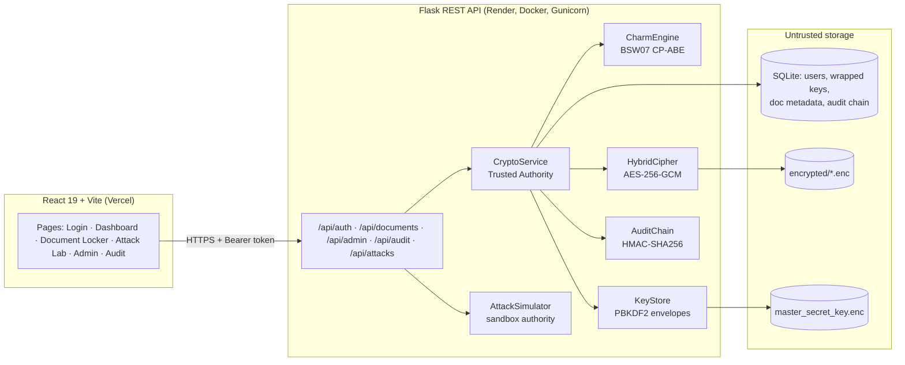

# SecureVault — CP-ABE Confidential Document Locker

**CS-3002 Information Security · Term Project · Topic 12: Attribute-Based Encryption (ABE) for Fine-Grained Access Control**

Team: Abdullah Khan · Syed Ali Zaidi · Maryam Imran

SecureVault is a full-stack document locker in which **access control is enforced by cryptography, not by the server**.
Every file is encrypted under an access policy such as

```
(Role:Engineer OR Role:Manager) AND Clearance:Level-3
```

and only a user whose private key carries attributes that satisfy that policy can decrypt it. A user with the wrong
attributes gets nothing back. The bilinear-pairing maths simply doesn't produce the key.

| | |
|---|---|
| **Live app** | _add your Vercel URL here after deploying_ |
| **API** | _add your Render URL here_ (`/api/health` returns `{"status":"ok"}`) |
| **Report** | [`documentation_deliverables/SecureVault_Project_Report.pdf`](documentation_deliverables/SecureVault_Project_Report.pdf) |
| **Slides** | [`documentation_deliverables/SecureVault_Presentation.pptx`](documentation_deliverables/SecureVault_Presentation.pptx) |

---

## Features

| Area | What it does |
|---|---|
| **CP-ABE core** | Genuine **BSW07** Ciphertext-Policy ABE from [Charm-Crypto](https://github.com/JHUISI/charm) over the BN254 pairing curve (Stanford PBC). |
| **Hybrid encryption** | CP-ABE encapsulates a random session element; its SHA-256 hash keys **AES-256-GCM**, which encrypts the document (KEM/DEM). |
| **Changing attributes** | Admin edits a user's role/clearance → user's next login transparently issues a new key → access changes immediately. |
| **Revocation** | **Epoch-based**: `Epoch:N` is an attribute inside every policy. Advancing the epoch and re-encrypting kills old keys mathematically. |
| **Key lifecycle** | Master key and every user key are stored only as **PBKDF2-HMAC-SHA256 (100k) + AES-256-GCM** envelopes. Admins never see user passwords. |
| **Audit trail** | Every security event is chained with **HMAC-SHA256**; one click verifies the whole chain. |
| **Attack Lab** | Launch 6 real attacks from the UI and watch each countermeasure hold (see below). |
| **Onboarding** | Dashboard walkthrough, persona test matrix, demo accounts on the login page, tooltips. |

## Demo accounts

Seeded automatically on first start (`backend/seed_data.py`). The sample document is encrypted under
`(Role:Engineer OR Role:Manager) AND Clearance:Level-3`.

| User | Password | Attributes | Expected result |
|---|---|---|---|
| `alice` | `Alice@2026!` | Role:Engineer, Clearance:Level-3 | ✅ decrypts |
| `charlie` | `Charlie@2026!` | Role:Manager, Clearance:Level-3 | ✅ decrypts |
| `bob` | `Bob@2026!` | Role:Student, Clearance:Level-3 | ❌ denied (wrong role) |
| `david` | `David@2026!` | Role:Engineer, Clearance:Level-2 | ❌ denied (clearance too low) |
| `admin` | `Admin@2026!` | Role:Engineer, Clearance:Level-3 + admin | ✅ decrypts, manages attributes/epochs/audit |

These are deliberately public demo credentials for a course project.

**Demo script: changing attributes.** Log in as `admin` → *Admin Panel* → *Edit Attributes* on `david` → set
`Clearance:Level-3`. Log in as `david`: the new key is claimed at login and the document now decrypts. Change him
back to `Level-2` and he is denied again.

---

## Architecture



### Encrypt → decrypt data flow

```mermaid
sequenceDiagram
    autonumber
    actor U as Uploader
    actor R as Reader
    participant API as Flask API
    participant ABE as CP-ABE (BSW07)
    participant AES as AES-256-GCM
    participant S as Storage
    U->>API: upload(file, policy)
    API->>ABE: M ← random GT element
    API->>AES: K = SHA-256(M); C = AES-GCM(K, file)
    API->>ABE: CT = Encrypt(PK, M, policy)
    API->>S: store C, nonce, tag, CT  (no plaintext, no K)
    R->>API: decrypt(doc, password)
    API->>S: load wrapped SK_R, C, CT
    API->>API: SK_R = unwrap(PBKDF2(password))  — RAM only
    API->>ABE: M' = Decrypt(PK, SK_R, CT)
    alt attributes satisfy policy
        API->>AES: verify tag, decrypt with SHA-256(M')
        API-->>R: 200 plaintext PDF
    else attributes don't satisfy policy / forged key
        API-->>R: 403 Access Denied
    end
```

More diagrams (upload, decryption, revocation, auth, audit chain) are in
[`documentation_deliverables/technical_diagrams/`](documentation_deliverables/technical_diagrams/ALL_TECHNICAL_DIAGRAMS.md).

---

## Threat model (summary)

| Party | Trust |
|---|---|
| Trusted Authority (holds master key, assigns attributes) | Fully trusted (co-located with the backend in this prototype) |
| Server & storage | **Honest-but-curious**; DB, files and backups may leak |
| Admin | Trusted to assign attributes; never learns user passwords |
| Users | Malicious: may collude, keep revoked keys, tamper with ciphertexts |
| Network | Untrusted; TLS provided by Render/Vercel |

**Guarantees:** confidentiality under policy, collusion resistance, ciphertext integrity, forward revocation via epochs,
tamper-evident audit log. **Not guaranteed:** compromise of the *running* Trusted Authority process (it holds the
master key in memory; production would use an HSM/KMS) and plaintext a legitimate user already downloaded. Full
analysis: Sections 23–27 of the report.

## Attack Lab: simulated attacks & countermeasures

Open **Attack Lab** in the app (any logged-in user) or call `POST /api/attacks/<id>/run`. Each attack runs real
cryptography against a throw-away sandbox authority. Measured results:

| # | Attack | Result | Why it fails |
|---|---|---|---|
| 1 | **Collusion**: Bob {Student, L3} + David {Engineer, L2} merge keys | 🛡 blocked (`PAIRING_MISMATCH`) | per-user randomness `r` in every BSW07 key component |
| 2 | **Policy tampering**: rewrite ciphertext policy to `Role:Student` | 🛡 blocked | `C'_y = H(attr)^q` binds the real attribute; AEAD seal |
| 3 | **Ciphertext bit-flip** (payload & tag) | 🛡 4/4 detected | AES-256-GCM authentication tag |
| 4 | **Revoked-key replay** after epoch 1 → 2 | 🛡 old key denied, new key works | epoch attribute in the access tree |
| 5 | **Password brute force** | 🛡 locked after 5 guesses; PBKDF2 ≈ 61,000× slower than SHA-256 | lockout + HTTP 429; PBKDF2 100k |
| 6 | **Timing side channel** (username enumeration) | 🛡 gap 26 ms → 0.6 ms | dummy PBKDF2 for unknown users |

The security review also found and fixed two real bugs: open self-registration with arbitrary attributes/admin role
(now admin-only), and an unhandled `InvalidCiphertext` that turned collusion attempts into HTTP 500 (now a clean 403).

## Security vs. usability (measured)

| Operation | Latency |
|---|---|
| KeyGen (2 / 4 / 8 attributes) | 5.0 / 8.6 / 13.3 ms |
| Hybrid encrypt (1 KB – 1 MB) | ≈ 28 ms |
| Authorized decrypt | ≈ 154 ms |
| Denied decrypt | ≈ 2.4 ms |
| PBKDF2 key unwrap (100k iterations) | ≈ 13 ms |

See Section 26 of the report for the trade-off discussion (PBKDF2 cost, policy size, revocation cost, lockout policy).

---

## Run it locally

Charm-Crypto needs Linux, so the backend runs in **WSL2 Ubuntu** (or any Linux / the Docker image); the frontend runs anywhere.

### 1. Backend (WSL / Linux)

```bash
# one-time: system libraries, PBC and Charm (same steps as backend/Dockerfile)
sudo apt-get install -y build-essential flex bison libgmp-dev libssl-dev python3-dev python3-pip
wget https://crypto.stanford.edu/pbc/news/pbc-0.5.14.tar.gz && tar xzf pbc-0.5.14.tar.gz
(cd pbc-0.5.14 && ./configure --prefix=/usr && make && sudo make install && sudo ldconfig)
git clone --depth 1 https://github.com/JHUISI/charm.git
(cd charm && ./configure.sh && make && sudo make install)

cd backend
pip3 install -r requirements.txt --break-system-packages
python3 app.py            # http://localhost:5000 — creates the authority and seeds demo users on first run
```

### 2. Frontend

```bash
cd frontend
npm install
npm run dev               # http://localhost:5173 (proxies /api to :5000)
```

### 3. Tests (backend, in WSL)

```bash
cd backend
python3 -m unittest tests.test_charm_bsw07 tests.test_access_matrix tests.test_hybrid_cipher tests.test_key_store tests.test_api tests.test_audit_chain_and_cors tests.test_phase4_revocation tests.test_attack_lab
python3 tests/benchmark_performance.py
```

75 tests: CP-ABE core, access matrix, hybrid cipher, key store, REST API, audit chain & CORS, revocation, attack lab.

---

## Deployment

**Backend → Render** (Docker). `render.yaml` is a Blueprint: *New → Blueprint →* pick this repo. It builds
`backend/Dockerfile` and sets `FLASK_ENV=production` plus auto-generated `JWT_SECRET`, `AUDIT_HMAC_SECRET`,
`MASTER_KEY_PASSPHRASE`. After the frontend is live, set `CORS_ALLOWED_ORIGINS` to its URL.
The free tier's disk is ephemeral; the app re-creates its authority and demo data on each cold start.

**Frontend → Vercel.** Import the repo, root directory `frontend`, framework *Vite*, env var
`VITE_API_BASE_URL=https://<your-render-service>.onrender.com/api`.

`backend/storage/` (database, encrypted master key, ciphertexts) is git-ignored and docker-ignored. **Never commit it.**

## Repository layout

```
backend/
  app.py, wsgi.py, config.py, seed_data.py, Dockerfile
  crypto/      charm_engine.py (BSW07) · hybrid_cipher.py · key_store.py · audit_chain.py
               service.py (Trusted Authority) · attack_simulator.py (Attack Lab)
  routes/      auth · documents · admin · audit · attacks
  utils/       auth.py (PBKDF2, tokens) · rate_limit.py (login lockout)
  tests/       75 unit/integration tests + benchmark
frontend/src/  pages/ (Login, Dashboard, Documents, AttackLab, AdminDashboard, AuditLogs), api.js
documentation_deliverables/  report (PDF/DOCX), slides, diagrams, screenshots
generate_final_report.py      regenerates the report (DOCX + PDF via Word)
render.yaml                   Render blueprint
```

## References

Bethencourt, Sahai, Waters. *Ciphertext-Policy Attribute-Based Encryption*, IEEE S&P 2007 ·
Akinyele et al. *Charm: a framework for rapidly prototyping cryptosystems*, 2013 ·
NIST SP 800-38D (GCM) · RFC 8018 (PBKDF2) · RFC 2104 (HMAC).
