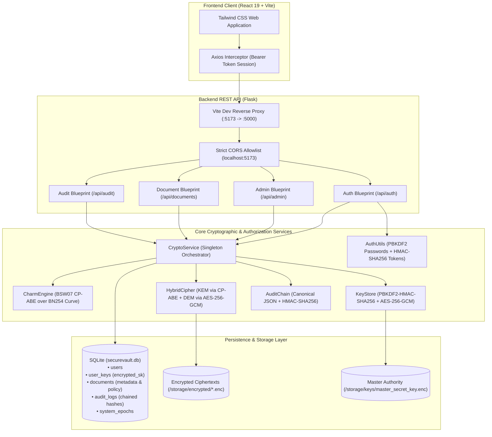
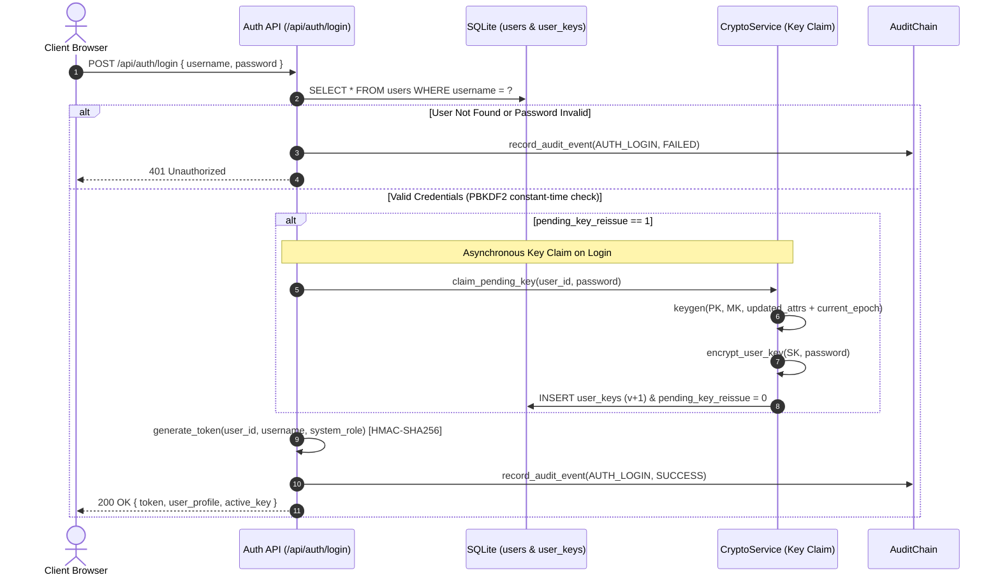
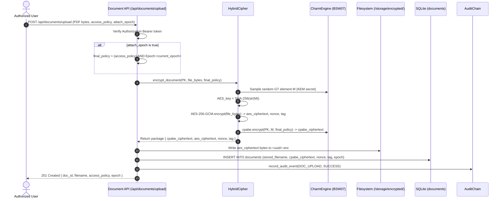
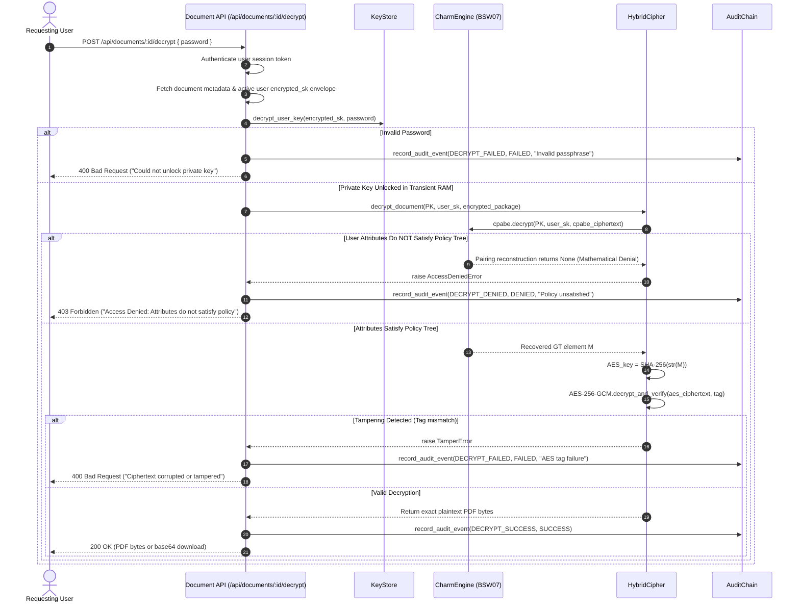
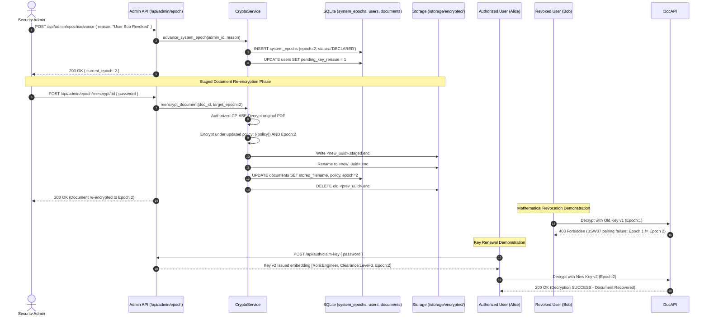

# SecureVault Technical Diagrams & Workflows

This document contains technical diagrams matching the actual implementation of the **SecureVault** codebase.

---

## Diagram 1: Overall SecureVault Architecture

---

## Diagram 2: User Login and Authentication Workflow

---

## Diagram 3: PDF Upload and Hybrid Encryption Workflow

---

## Diagram 4: CP-ABE Authorization and Decryption Workflow

---

## Diagram 5: Epoch-Based Revocation Workflow

---

## Diagram 6: HMAC-SHA256 Audit Log Chaining Architecture

```mermaid
flowchart LR
    subgraph GenesisBlock["Genesis State"]
        G0["Genesis Hash\n0000...0000 (64 zeros)"]
    end

    subgraph Event1["Audit Record #1"]
        direction TB
        C1["Canonical Representation #1\n• sequence_number: 1\n• timestamp: 2026-11-10 10:00:00\n• user_id: 1\n• username: admin\n• action: AUTH_LOGIN\n• status: SUCCESS\n• details: User logged in\n• ip_address: 127.0.0.1\n• previous_hash: 0000...0000"]
        H1["HMAC-SHA256(K_audit, C1)\n= record_hash #1"]
        C1 --> H1
    end

    subgraph Event2["Audit Record #2"]
        direction TB
        C2["Canonical Representation #2\n• sequence_number: 2\n• timestamp: 2026-11-10 10:02:15\n• user_id: 1\n• username: admin\n• action: DOC_UPLOAD\n• status: SUCCESS\n• details: Uploaded report.pdf\n• ip_address: 127.0.0.1\n• previous_hash: record_hash #1"]
        H2["HMAC-SHA256(K_audit, C2)\n= record_hash #2"]
        C2 --> H2
    end

    subgraph Event3["Audit Record #3"]
        direction TB
        C3["Canonical Representation #3\n• sequence_number: 3\n• timestamp: 2026-11-10 10:05:30\n• user_id: 2\n• username: bob\n• action: DECRYPT_DENIED\n• status: DENIED\n• details: CP-ABE denial\n• ip_address: 192.168.1.20\n• previous_hash: record_hash #2"]
        H3["HMAC-SHA256(K_audit, C3)\n= record_hash #3"]
        C3 --> H3
    end

    G0 -->|previous_hash| C1
    H1 -->|previous_hash| C2
    H2 -->|previous_hash| C3

    subgraph VerificationEngine["Verification Engine (verify_chain_integrity)"]
        V["1. Check Sequence: 1, 2, 3... Contiguous\n2. Check Link: Record[i].previous_hash == Record[i-1].record_hash\n3. Check Signature: HMAC(K_audit, Canon(Record[i])) == record_hash[i]\n\nResult: 100% Intact OR Tampering Detected (Mod, Swap, Del)"]
    end

    H3 -.-> V
```

